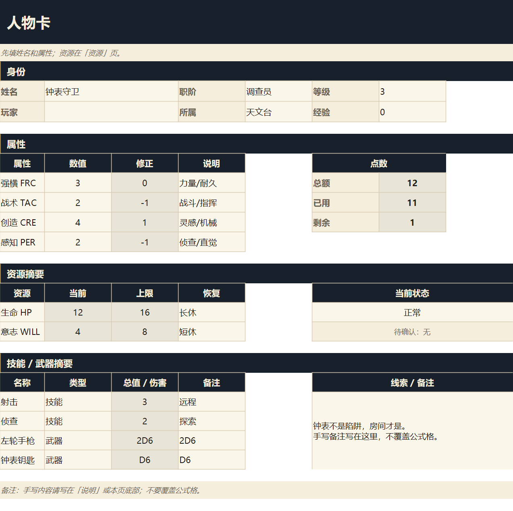

# TRPG 翻译工坊

**DeepSeek Harness 插件**：把一份 TRPG 模组 PDF 变成一本可读的中文排版书，另附一个独立的 Excel 人物卡面板。

当前版本 **2.2.0**（插件页标题旁会显示版本号） · 开发者：希亚蕾丝



## 它做什么

工坊不直接翻全篇。它先把资料整理成项目，生成一份只讲当前阶段的任务书，让 Agent 先做「预览页 + 难页」；你审核通过后再继续全篇。

- 上传模组 PDF，可选上传术语表；首轮只产出 `out/pass1/preview.pdf/png` 与 `hard.pdf/png` + `REPORT.md`。
- 源语言支持**英语 / 德语 / 波兰语** → 中文：保留 ä ö ü ß 与 ą ć ę ł ń ó ś ź ż，带对应语言的术语表、整段残留检测和校对清单。
- 「纸本档案」版式：奶油纸、黑墨、金线、红色菱形、深表头表格、朗读框、规则条、便签、数据块。
- 表格优先：人物卡、武器/护甲、法术/能力、随机表、房间钥匙优先做表；原卡难以表格化时保留原图到附录。
- 全篇按批次流水线推进（每批 ≤16 源页），逐批翻译 → 独立校对（`PROOF.json`）→ `batch-check` → 构建。
- 术语门禁：英文特技/道途清单、原型名不一致、术语表缺条目会直接阻断。
- 全书 PDF 书签（WPS/Adobe 可展开），A4 打印、0 Type3 检查。
- 侧栏另有独立实验面板 **Excel 车卡**：生成带资源、车卡步骤、公式和固定版式的 `.xlsx`；自动识别 Quickstart / 模组里的**预设角色**（pregen / NPC），≤8 张合成一个工作簿，>8 张拆成多文件 + 索引，空白人物卡与预设卡分开。

详细说明见 [`trpg-pdf-forge/README.md`](trpg-pdf-forge/README.md)，阶段与门禁见 [`assets/WORKFLOW.md`](trpg-pdf-forge/assets/WORKFLOW.md)。

## 版本与更新报告

- 更新日志：[`CHANGELOG.md`](CHANGELOG.md)
- 2.0.1 → 2.2.0 完整更新报告：[`docs/UPDATE-REPORT-2.2.0.md`](docs/UPDATE-REPORT-2.2.0.md)（预设卡、德语 / 波兰语源、工作区目录修复）

## 仓库结构

```
trpg-pdf-forge/         插件本体（安装这个目录）
  index.js  client.js    Host / Client 入口
  server/                工坊后端（项目、路由、批次、回收站）
  assets/                排版脚本、模板、演示样张、文档
  test/                  76 项 node:test 测试
sheet-demo-project/     Excel 车卡示例产出（xlsx + plan + QA + 预览图）
docs/                   更新报告
```

## 安装

1. `git clone` 或下载本仓库（不要只下载 zip 里的单个文件）。
2. DeepSeek Harness → 设置 → 插件 → 从本地目录安装，选中 **`trpg-pdf-forge/`** 文件夹。
3. 重启 DSH，侧栏出现「翻译工坊」与「Excel 车卡 · 实验」。

运行环境：DSH 桌面版（Windows）。PDF 打印使用本机 Chrome/Edge；Python 辅助脚本通过 `assets/run-python.mjs` 自动寻找 DSH 自带运行时，无需另装 Python。

> 从 2.0.x / 2.1.x 升级到 2.2.0：`client.js` 与 `server/*.mjs` 有改动，**必须完整重启 DSH**，只刷新页面不会加载新代码。

## 开发与测试

```powershell
cd trpg-pdf-forge
node --test test/*.test.mjs
```

2.2.0 下 76 项全部通过。

## 状态与限制

- 实验 / beta：复杂规则、特殊版式仍需人工校对。
- 预设卡提取由 Agent 对照源页写入 `work/pregens.json`，插件负责检测、生成和 QA，不是全自动版面解析。
- 德语 / 波兰语源仍需 PROOF 语义校对；自动文本/术语门禁不能替代逐段校对。
- 本轮波兰语只覆盖“波兰语源 → 中文”，不包含完整波兰语目标排版。
- openpyxl 不计算公式；Excel 打开时由 `fullCalcOnLoad` 重算。只生成 `.xlsx`，不含宏。
- 演示样张 [`assets/demo/`](trpg-pdf-forge/assets/demo) 为原创迷你模组，不含任何商业模组正文或插图。

## 许可

见 [LICENSE](LICENSE)。
